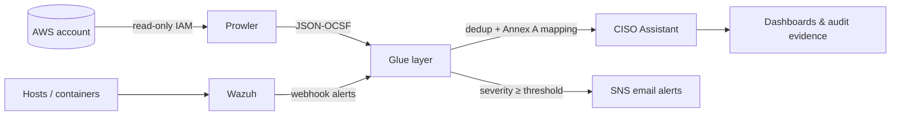

# AWS ISO 27001 Infrastructure Readiness Toolkit

Continuous ISO 27001:2022 (Annex A) and SOC 2 readiness monitoring for an AWS account. It combines three open-source tools with a Python integration layer:

- **[Prowler](https://github.com/prowler-cloud/prowler)** scans AWS resources against compliance checks.
- **[Wazuh](https://wazuh.com)** provides host intrusion detection, file integrity monitoring and centralized logs.
- **[CISO Assistant](https://github.com/intuitem/ciso-assistant-community)** is the GRC tracker, holding control status, evidence and gaps against Annex A.
- **Glue layer** (`glue/`) maps findings to controls, deduplicates them across runs, tracks deltas and pushes the results into CISO Assistant.

## Architecture



Every component runs under one `docker-compose.yml`, both locally and on a single EC2 instance (a `t3.large` with 8 GB RAM is enough).

## What it checks

| AWS service | Annex A controls | Example checks |
| --- | --- | --- |
| IAM | A.5.15, A.5.17 | MFA, password policy, unused credentials, root usage |
| S3 | A.8.10, A.8.24 | Public access blocks, encryption, versioning, access logs |
| EC2 / VPC | A.8.20, A.8.21 | Open ports, security groups, flow logs, public IPs |
| CloudTrail | A.8.15, A.8.16 | Multi-region trails, log validation |
| RDS | A.8.13, A.8.24 | Encryption, public access, backups, Multi-AZ |
| KMS | A.8.24 | Key rotation, key policies |
| Lambda, ECS/EKS, Config | A.8.9 | Runtimes, secrets, image scanning, recorder status |
| GuardDuty | A.8.16 | Detector enabled, findings export |

Beyond the Prowler findings, the glue layer also runs:

| Module | Purpose |
| --- | --- |
| `access_reviewer.py` | Periodic IAM access review report (HTML) |
| `asset_inventory.py` | Syncs AWS resources into the CISO Assistant asset register |
| `backup_verifier.py` | Verifies backup configuration against policy |
| `encryption_auditor.py` | Encryption-at-rest coverage |
| `log_auditor.py` | Required logging per service |
| `network_monitor.py` | Risky ports and exposure |
| `incident_detector.py` | Raises incidents from Wazuh alerts using rules in `mappings/` |
| `sla_tracker.py` | Remediation SLA tracking by severity |

Control mappings live in `glue/mappings/*.json`, so you can extend them without touching code.

## Quick start (local)

Requirements: Docker with at least 8 GB RAM allocated, and AWS CLI credentials for the account you want to scan.

```bash
cp .env.example .env          # fill in the secrets section (.env is gitignored)
docker compose up -d          # CISO Assistant + Wazuh
./glue/run_scan.sh delta      # IAM, S3, CloudTrail, EC2
./glue/run_scan.sh full       # every service, every region
```

- CISO Assistant: http://localhost:8443
- Wazuh dashboard: https://localhost:5601

## Deploy to AWS

```bash
cd terraform
terraform init
terraform apply \
  -var ami_id=ami-xxxxxxxx \
  -var key_pair_name=my-key \
  -var 'allowed_dashboard_cidrs=["203.0.113.0/24"]'
```

This provisions an EC2 instance with a dedicated EBS data volume. The instance gets an IAM profile with `SecurityAudit` plus read-only extras, and `scripts/init-secrets.sh <secret-id>` loads secrets from Secrets Manager into a tmpfs-backed `.env`. Scans run on cron: a delta scan daily and a full scan weekly. The schedules are set in `.env`.

## Scope

The automated scanning covers technical controls that can be verified through AWS APIs. Organizational controls (policies, vendors, HR, incidents) are tracked by hand in the same CISO Assistant instance, so everything stays in one place. See [`AWS_ISO27001_Toolkit_Spec.md`](AWS_ISO27001_Toolkit_Spec.md) for the full specification.
